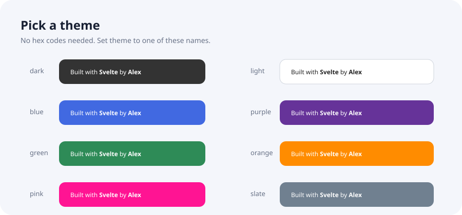
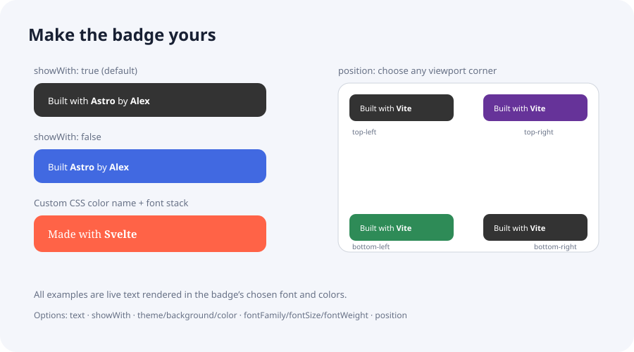

# Built With Badge

Add a customizable "Built with / by" badge to a website. Use the Svelte component, framework-free JavaScript API, or one CDN script.

## Install

```sh
npm install @tahahameed23/built-with
```

## Badge examples

### Themes

Choose a preset theme without writing hex colors:



### Text, typography, and position

The label, optional “with”, font, and corner position are customizable:



## Usage

### Svelte

```svelte
<script>
    import { Badge } from "@tahahameed23/built-with";
</script>

<Badge
    builtWith="Svelte"
    by="Your name"
    text="Built"
    showWith={true}
    position="bottom-right"
    theme="purple"
    fontFamily="Georgia, serif"
    fontSize="13px"
    href="https://example.com"
/>
```

### Vanilla JavaScript

```js
import { mountBadge } from "@tahahameed23/built-with/vanilla";

const badge = mountBadge({
    builtWith: "Svelte",
    by: "Your name",
    text: "Built",
    showWith: false,
    position: "bottom-right",
    theme: "blue",
    fontFamily: "Arial, sans-serif",
    fontSize: "13px",
    href: "https://example.com",
});

// Remove the badge when it is no longer needed.
badge.destroy();
```

`mountBadge` also works before `document.body` exists. It mounts when the DOM is ready. Calling `destroy()` before then cancels the pending mount.

### CDN script

Add the script near the end of `<body>`. It also works in `<head>` and waits for the page body. No framework or separate stylesheet is required.

```html
<script
    src="https://cdn.jsdelivr.net/npm/@tahahameed23/built-with@0.0.1/dist/cdn/badge.js"
    data-builtwith="Svelte"
    data-by="Your name"
    data-text="Built"
    data-show-with="false"
    data-position="bottom-right"
    data-theme="green"
    data-font-family="Arial, sans-serif"
    data-font-size="13px"
    data-href="https://example.com"
></script>
```

Pin a published version in production. Update the version in the URL when you want to upgrade.

## Options reference

The Svelte component and `mountBadge(options)` support all options in the table. The CDN script accepts the matching `data-*` attribute shown in the last column.

| Option       | Type                                                                                     | Default                   | Description                                                                                                                                                                 | CDN attribute      |
| ------------ | ---------------------------------------------------------------------------------------- | ------------------------- | --------------------------------------------------------------------------------------------------------------------------------------------------------------------------- | ------------------ |
| `builtWith`  | `string`                                                                                 | `"⚡"`                    | Name, technology, or text displayed after the label.                                                                                                                        | `data-builtwith`   |
| `by`         | `string`                                                                                 | `"someone"`               | Name or attribution displayed after “by”.                                                                                                                                   | `data-by`          |
| `text`       | `string`                                                                                 | `"Built with"`            | Label shown before `builtWith`. The `showWith` setting adds or removes the final “with”.                                                                                    | `data-text`        |
| `showWith`   | `boolean`                                                                                | `true`                    | Add “with” to the end of `text`. If `text` already ends in “with”, it is not duplicated. Set `false` for labels like “Built Svelte”.                                        | `data-show-with`   |
| `position`   | `"top-left"`, `"top-right"`, `"bottom-left"`, or `"bottom-right"`                        | `"bottom-right"`          | Fixed position in the viewport, with a 10px edge offset. Unsupported values fall back to `bottom-right`.                                                                    | `data-position`    |
| `theme`      | `"dark"`, `"light"`, `"blue"`, `"purple"`, `"green"`, `"orange"`, `"pink"`, or `"slate"` | `"dark"`                  | Preset background and text colors. Unsupported themes fall back to `dark`.                                                                                                  | `data-theme`       |
| `background` | CSS color string                                                                         | Theme background          | Custom badge background. Overrides the theme background. Accepts CSS names such as `"tomato"` and CSS variables such as `"var(--brand-color)"`; hex, RGB, and HSL work too. | `data-bg`          |
| `color`      | CSS color string                                                                         | Theme text color          | Custom text color. Overrides the theme text color. Accepts CSS names and variables as well as hex, RGB, and HSL.                                                            | `data-color`       |
| `fontFamily` | CSS font-family string                                                                   | `"system-ui, sans-serif"` | Font stack for the badge. Use an installed/system font stack or `"inherit"`; this option does not download fonts.                                                           | `data-font-family` |
| `fontSize`   | CSS length string                                                                        | `"12px"`                  | Badge font size, for example `"14px"` or `"0.875rem"`.                                                                                                                      | `data-font-size`   |
| `fontWeight` | CSS font-weight string or number                                                         | `500`                     | Font weight, for example `400`, `600`, or `"bold"`.                                                                                                                         | `data-font-weight` |
| `href`       | HTTP(S) or relative URL string                                                           | None                      | Optional link applied to the whole badge. Other URL protocols are rejected.                                                                                                 | `data-href`        |
| `zIndex`     | finite number                                                                            | `9999`                    | CSS stacking order for the fixed badge.                                                                                                                                     | `data-z-index`     |

### Choosing colors without hex

The easiest option is to set a preset `theme`, such as `theme="purple"`. For custom colors, use familiar CSS color names or your own CSS custom properties:

```svelte
<Badge theme="dark" background="tomato" color="white" />
<Badge background="var(--brand-color)" color="var(--brand-on-color)" />
```

Custom `background` and `color` override the selected theme. For the CDN, use the same CSS values in `data-bg` and `data-color`.

### CDN boolean and numeric attributes

Set `data-show-with="false"` to hide “with”; omit the attribute or set it to `"true"` to include it. `data-z-index` must contain a finite number, for example `data-z-index="10000"`.

## Build and publish

```sh
npm run release:check
npm run release:publish
```
